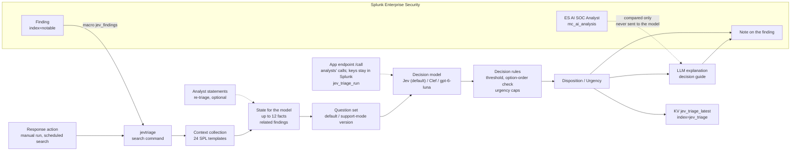
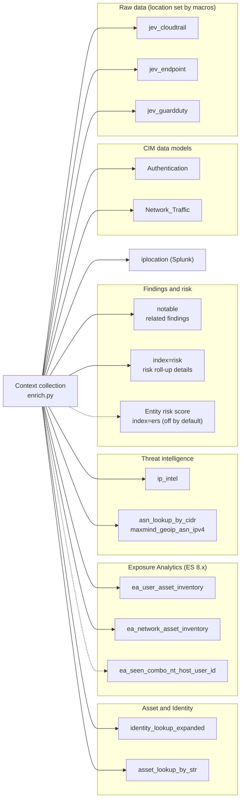
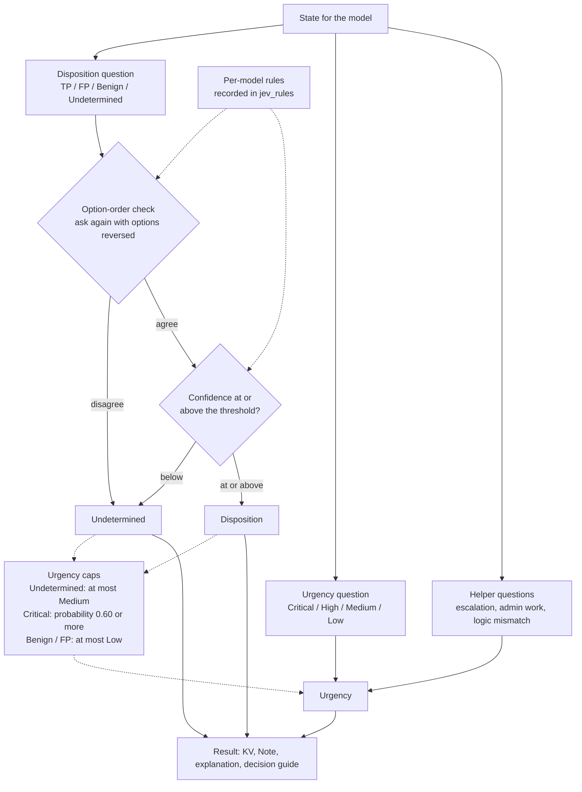

# How it works — context for the decision model

[日本語](../ja/how-it-works.md)

This page shows how Second Opinion Triage turns an ES finding into a suggestion: which Enterprise Security data it
reads, which facts it passes to the decision model, how the answer becomes a disposition and an urgency, and which
kinds of context were tried and left out. Version 1.2.

## 1. Overall flow

For each finding the app collects facts with SPL, writes them as short English sentences (up to 12), and sends them to
the decision model together with related findings. The answer is turned into a disposition and an urgency by
per-model rules and kept in the app's KV store; it can be written to the ES finding as a Note.

## 2. Where the facts come from

Every source says nothing when its data is missing (not ES, source disabled, no row), and records no error.
Dotted lines are optional or planned.

| Source | Template | Facts passed to the model (examples) | Since |
|---|---|---|---|
| Asset and Identity | `identity` | Role (employee, service account, privileged), department, priority, watchlist, end date (left or retired), the person's own hosts. A role session (`Role/session`) is looked up as itself | 0.13.8 |
| | `asset` | In the inventory or not, category, priority, department, owner, expected asset or not. Hosts missing from the inventory are listed in one line | 0.13.8 |
| Exposure Analytics | `ea_user` | Non-human identity (left out when the inventory already says service account), the person behind an account, known for 30+ days before the alert | 0.13.8 |
| | `ea_host` | Environment, cloud provider, short-lived instance, known for 30+ days before the alert | 0.13.8 |
| Threat intelligence | `ip_intel` | The source address is listed in ES threat intelligence (list names, description, weight); only a match is reported | 0.13.4 |
| | `ip_asn` | Network owner (ASN organisation); hosting or cloud provider | 0.13.3 |
| Findings and risk | `related_alerts` | Other findings on the same user, host or address | — |
| | `rollup_window`, `change_window` | Risk roll-ups are looked at over the period of the detections behind them | — |
| | `rollup_contributors` | What was behind the risk gathered on a shared resource (which change, by whom) | — |
| | `entity_risk` | ES 8 entity risk score at the time of the alert and the other detections behind it. **Off by default** (`ers=`) | 0.13.9 |
| CIM data models | `auth_outcome` | Sign-ins from the source succeeded or failed (CIM values only) | — |
| | `traffic_outcome` | The firewall blocked the source | — |
| CloudTrail (`jev_cloudtrail`) | `cloud_user` | Source addresses, writes, permission changes, admin rights granted, MFA changes, instances launched | — |
| | `cloud_user_baseline` | New source addresses compared with the previous 30 days | — |
| | `cloud_ip_peers` | Other accounts on the same addresses, failed sign-ins | — |
| | `change_actor` | Who made a change, console or API | — |
| | `cloud_user_origin` | When, by whom and from where an account was created, and what it was given | 0.13.2 |
| | `cloud_users_known` | The name imitates another account (look-alike characters) | 0.13.2 |
| | `cloud_session` | An AWS service made the calls on the identity's behalf (`invokedBy`, not the console); SAML single sign-on | 0.14.3 |
| Endpoint (`jev_endpoint`) | `endpoint_powershell` | Hidden-window or Base64 PowerShell | — |
| | `win_actor` | The same person cleared logs, deleted or created accounts, changed groups | 0.13.2 |
| GuardDuty (`jev_guardduty`) | `guardduty_detail` | Severity, probed ports and probing organisations, API caller's organisation and country; narrowed to the finding's instance or access-key user; sample findings reported as such | 0.14.3 |
| Splunk | `ip_location` | Country of the source address | 0.13.2 |

### Tried and left out

Each was measured on labelled findings and lowered correct verdicts, so it is not passed (some can be turned on for
evaluation).

| Context | What happened |
|---|---|
| Console sign-ins and MFA | A legitimate employee became Undetermined |
| Kind of API client | A compromised account looked like automation |
| Active days in the previous week | "No activity" misled on short data |
| GuardDuty threat-list match | Internet-wide scanning was pushed to true positive |
| Recent "first seen" times | Present on almost every finding; mostly the start of data collection (only 30+ days is kept) |
| Looking up a role session by its role | A misused session looked like a known service account |
| Running risk score band (`risk_score`) | Includes later detections, old scale; lowered true positives (`riskband=true`) |
| Entity risk score to bound urgency | "At least medium from 50" pushed correct low findings up |
| Detection output (fields the rule wrote) | The rule's own wording pulled benign findings to true positive (`details=true`) |

## 3. Decision and output

With analyst statements (1.1), the state also carries `analyst_statements`, apart from the facts. The model takes
them as true, so the same run also asks without them; the result without statements and a warning when the facts
alone point to a true positive are kept and written to the Note.

ES investigations (1.2) are not part of the state either: the model judges each finding on its own facts. The app
reads the investigations only to show them, to use an investigation's disposition as the analyst's decision in the
agreement rate (when the finding's own disposition is still Undetermined), and to aggregate the stored results of an
investigation's findings into a summary Note (optionally with an LLM text written from those stored facts and results).

The threshold and the order check depend on the model, and the rules used are kept in `jev_rules`; the reasons for
any change to the model's answer are in `jev_policy`. The wording of the questions can be changed in support mode;
the version used is kept in `jev_questions`.

## 4. Rules for collecting context

- **No data**: say nothing and record no error (not ES, source disabled).
- **No reassurance**: negative facts such as "not a hosting network" or "no other account used this address"
  lowered true positives and are not written.
- **No record is not no activity**: short data and retention make the absence of records misleading.
- **Shared resources**: cloud endpoints such as `*.amazonaws.com` are never used as join keys.
- **Twelve facts**: strong, rare clues (how an account came to exist, look-alike names) first; inventory lines are
  merged so that they do not push others out.
- **Facts, not verdicts**: summarised scores ("risk is high / low"), the rule's own wording, and inventory readings
  such as "a known account" pull the model. Pass what happened, not an assessment of it.
- **Before adding a fact**: run the labelled sets (true-positive heavy sets and a set of benign and false alerts) in
  turn, twice, and keep the change only when no verdict gets worse.

Sources: `bin/jev_triage/enrichment_templates.json` (SPL), `bin/jev_triage/enrich.py` (facts),
`bin/jev_triage/state.py` (state), `bin/jev_triage/policy.py` and `rules.py` (decision rules).
