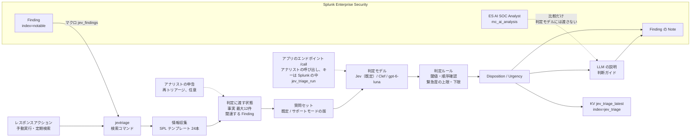
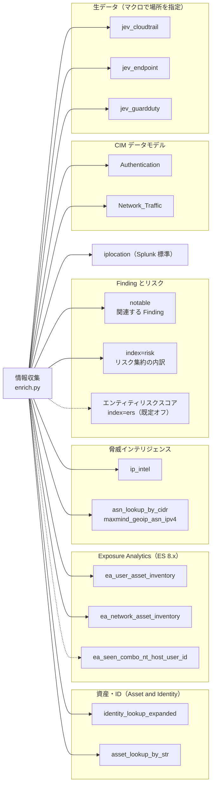
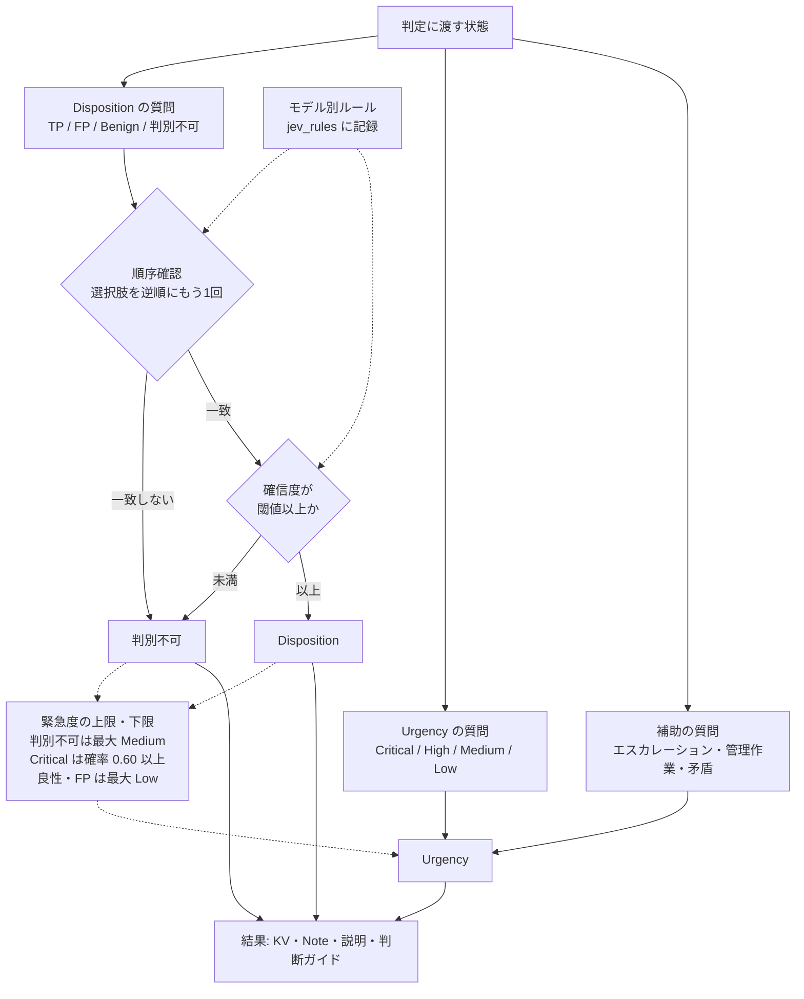

# 仕組み — 判定モデルに渡すコンテキスト

[English](../en/how-it-works.md)

Second Opinion Triage が ES の Finding から提案を作るまでの流れです。Enterprise Security のどのデータを読み、どの事実を判定
モデルに渡し、答えをどう Disposition と Urgency にするか、また試して外した情報をまとめています。1.2 時点。

## 1. 全体の流れ

Finding 1件ごとに SPL で事実を集めて短い英文（最大12件）にし、関連する Finding とあわせて判定モデルに渡します。答えは
モデル別のルールで Disposition と Urgency にまとめ、アプリの KV に残します。ES の Finding に Note として書くこともできます。

## 2. 事実の出どころ

どのソースも、データがない場合（ES でない、ソースが無効、行がない）は何も書かず、エラーも記録しません。点線は任意または予定です。

| 出どころ | テンプレート | 判定モデルに渡す事実（例） | 版 |
|---|---|---|---|
| 資産・ID | `identity` | 役割（社員・サービスアカウント・特権）、部署、優先度、ウォッチリスト、終了日（退職・廃止）、本人の端末。ロールのセッション（`Role/session`）はそのままの名前で照合 | 0.13.8 |
| | `asset` | 台帳にあるか、カテゴリ、優先度、部署、所有者、想定内の資産か。台帳にないホストは1行にまとめる | 0.13.8 |
| Exposure Analytics | `ea_user` | 人以外の ID（台帳でサービスアカウントなら省く）、背後の人物、アラートの30日以上前から把握済みか | 0.13.8 |
| | `ea_host` | 環境、クラウド事業者、短命なインスタンスか、30日以上前から把握済みか | 0.13.8 |
| 脅威インテリジェンス | `ip_intel` | 送信元が ES の脅威情報に載っている（リスト名・説明・重み）。一致したときだけ | 0.13.4 |
| | `ip_asn` | ネットワークの持ち主（ASN の組織）、ホスティング・クラウド事業者か | 0.13.3 |
| Finding とリスク | `related_alerts` | 同じ人・ホスト・アドレスの別の Finding | — |
| | `rollup_window`、`change_window` | リスク集約の Finding は、元の検知が起きた期間で調べ直す | — |
| | `rollup_contributors` | 共有資源に集まったリスクの内訳（どの変更、誰が） | — |
| | `entity_risk` | ES 8 のエンティティリスクスコア（アラート時点）と寄与した検知。**既定オフ**（`ers=`） | 0.13.9 |
| CIM データモデル | `auth_outcome` | 送信元からのログインの成否（CIM の値のときだけ） | — |
| | `traffic_outcome` | ファイアウォールが送信元を遮断したか | — |
| CloudTrail（`jev_cloudtrail`） | `cloud_user` | 送信元アドレス、書き込み、権限変更、管理者権限の付与、MFA の変更、インスタンスの起動 | — |
| | `cloud_user_baseline` | 過去30日と比べて新しいアドレスか | — |
| | `cloud_ip_peers` | 同じアドレスを使った別のアカウント、失敗したログイン | — |
| | `change_actor` | 変更の実行者と、コンソールか API か | — |
| | `cloud_user_origin` | アカウントがいつ・誰に・どこから作られ、何を与えられたか | 0.13.2 |
| | `cloud_users_known` | 既存の名前と見間違えやすい名前か | 0.13.2 |
| | `cloud_session` | AWS のサービスが代わりに実行した（`invokedBy`、コンソールは除く）、SAML のシングルサインオン | 0.14.3 |
| エンドポイント（`jev_endpoint`） | `endpoint_powershell` | 隠しウィンドウや Base64 の PowerShell | — |
| | `win_actor` | 同じ人物のログ消去・アカウント削除や作成・グループ変更 | 0.13.2 |
| GuardDuty（`jev_guardduty`） | `guardduty_detail` | 重大度、探査されたポートと探査元の組織、API の呼び出し元の組織と国。その検出結果のインスタンス・ユーザーに絞り、サンプルの検出結果はその旨 | 0.14.3 |
| Splunk 標準 | `ip_location` | 送信元の国 | 0.13.2 |

### 試して外したもの

いずれも正解付きの Finding で測り、正しい判定を下げたため渡していません（一部は評価用に有効にできます）。

| 情報 | 起きたこと |
|---|---|
| コンソールのログインと MFA | 正規の社員が判別不可に |
| API の利用者の種類 | 乗っ取られたアカウントが「自動化処理」に見えた |
| 前の週の活動日数 | 短いデータで「活動なし」が誤解を招いた |
| GuardDuty の脅威リスト一致 | インターネット全体のスキャンを TP に押し上げた |
| 最近の「最初に見た時期」 | ほぼ全件に付くノイズ。多くはデータの取り込み開始日（30日以上前のときだけ残した） |
| ロールのセッションをロール名で照合 | 悪用されたセッションが既知のサービスアカウントに見えた |
| 累計リスクスコアの目安（`risk_score`） | 後の検知も含む古い尺度。TP の確信度を下げた（`riskband=true`） |
| エンティティリスクスコアで緊急度を補正 | 「50以上は最低 medium」が正解 low を押し上げた |
| 検知の出力（ルールが書いた項目） | ルール自身の文言が良性を TP に寄せた（`details=true`） |

## 3. 判定と出力

アナリストの申告（1.1）があるときは、状態に事実とは別に `analyst_statements` が入ります。モデルは申告を正しいものとして
扱うので、同じ実行で申告なしでも聞き、申告なしの判定と、事実だけでは TP を示すときの警告を残して Note に書きます。

ES の調査（1.2）も状態には入れません。モデルは各 Finding をその Finding の事実だけで判定します。アプリが調査を読むのは、
表示すること、Finding 自身の Disposition がまだ Undetermined のときに調査の Disposition を一致率のアナリストの判断として
使うこと、調査内の Finding の保存済みの結果を集めてまとめの Note を書くこと（任意で、保存した事実と結果から LLM が書く文章を
添える）のためだけです。

閾値と順序確認の有無はモデルごとに決まり、使ったルールは `jev_rules` に、モデルの答えを変えた理由は `jev_policy` に残ります。
質問の文言はサポートモードで差し替えられ、使った版は `jev_questions` に残ります。

## 4. 情報収集のきまり

- **データがない**: そのソースの事実は書かない。エラーも記録しない（ES でない環境、無効なソース）。
- **安心材料を書かない**: 「ホスティングではない」「他のアカウントは使っていない」のような否定の事実は TP の確信度を下げたので書かない。
- **記録がないこと**: 「記録がない」と「活動していない」は区別する。短いデータや保存期間の都合で誤解を招く。
- **共有資源**: `*.amazonaws.com` などのクラウドのエンドポイントは照合のキーにしない。
- **12件の枠**: 強くまれな手がかり（アカウントの成り立ち、見間違えやすい名前）を先に、台帳の行はまとめて枠を押し出さない。
- **事実を渡し、評価は渡さない**: 「リスクが高い・低い」の点数、ルール自身の文言、「既知のアカウント」のような台帳の読み替えは
  モデルを引きずる。何が起きたかを渡す。
- **事実を足す前に**: 正解付きのデータ（TP 中心のものと、良性・FP を集めたもの）を順番に2回流し、判定が悪化しないときだけ採用する。

出どころ: `bin/jev_triage/enrichment_templates.json`（SPL）、`bin/jev_triage/enrich.py`（事実）、`bin/jev_triage/state.py`（状態）、
`bin/jev_triage/policy.py` と `rules.py`（判定ルール）。
